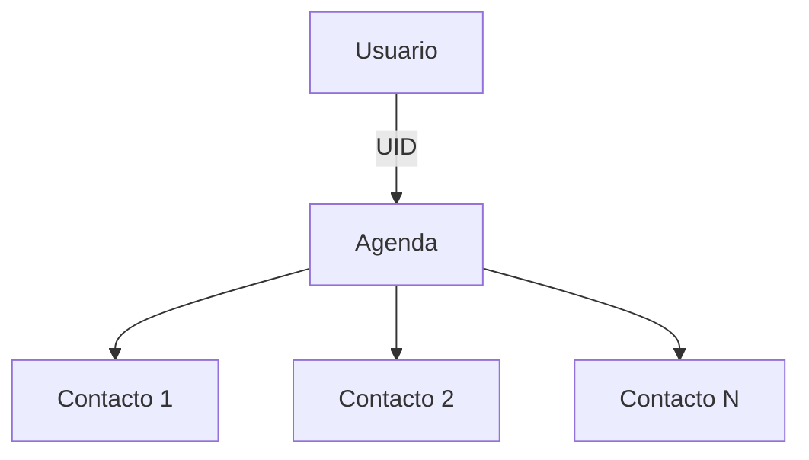

# 📒 AgendaVue

> **Tu agenda de contactos personal, sencilla y accesible desde cualquier navegador.**

[Aplicación web](https://agenda-vue-iw-11.netlify.app/) · [Funcionalidades](#-funcionalidades) · [Puesta en marcha](#-puesta-en-marcha) · [Modelo de datos](#-modelo-de-datos) · [Estructura](#-estructura)

---

AgendaVue es una aplicación web de una sola página (SPA) desarrollada con **Vue.js**, que permite almacenar y gestionar contactos sin necesidad de recargar la página.

La aplicación se ha desarrollado a partir de la plantilla proporcionada en la asignatura de Ingeniería Web, conservando las tecnologías utilizadas en clase y ampliando progresivamente sus funcionalidades.

## ✨ Funcionalidades

| | Qué permite hacer |
| --- | --- |
| 📋 **Contactos** | Consultar los nombres, correos electrónicos y teléfonos guardados. |
| ➕ **Añadir** | Incorporar nuevos contactos mediante un formulario con validación. |
| 🗑️ **Eliminar** | Eliminar contactos mediante una confirmación integrada en el listado. |
| ⚡ **Reactividad** | Actualizar automáticamente el listado y el contador sin recargar la página. |
| ☁️ **Persistencia** | Almacenar los contactos en Firebase Firestore mediante Vuefire. |
| 🔐 **Privacidad** | Mantener una agenda independiente para cada usuario mediante autenticación anónima. |
| 📱 **Responsive** | Utilizar la aplicación desde dispositivos con diferentes tamaños de pantalla. |

## 🛠️ Tecnologías

| Tecnología | Uso |
| --- | --- |
| Vue.js 2.6.10 | Gestión de datos, formularios y reactividad. |
| jQuery | Navegación y efectos visuales. |
| Bootstrap | Estructura y componentes de la interfaz. |
| Font Awesome | Iconos de la aplicación. |
| Firebase 7.24.0 | Autenticación y almacenamiento de datos. |
| Vuefire 2.2.5 | Sincronización de los datos de Firestore con Vue. |
| Netlify | Alojamiento de la aplicación. |

Se han conservado las tecnologías de la plantilla docente, personalizando la interfaz y ampliando el código original.

## 🚀 Puesta en marcha

La aplicación está disponible en:

**https://agenda-vue-iw-11.netlify.app/**

Para ejecutarla en local, basta con descargar o clonar el repositorio y abrir `index.html` mediante un servidor HTTP local, como Live Server de Visual Studio Code.

No es necesario instalar dependencias mediante npm ni realizar ningún proceso de compilación.

### Configuración de Firebase

Para utilizar un proyecto Firebase propio:

1. Crear un proyecto en Firebase y registrar una aplicación web.
2. Activar la autenticación anónima.
3. Crear una base de datos Cloud Firestore.
4. Publicar las reglas de seguridad incluidas en `firestore.rules`.
5. Introducir los valores de configuración web en `js/firebase-config.js`.

Si no se configura Firebase, la aplicación funciona en modo local, aunque los contactos no se conservan al recargar la página.

## 🧩 Modelo de datos

Cada contacto contiene tres atributos principales: nombre, correo electrónico y teléfono.

Los contactos se almacenan en Firestore, organizados por el identificador del usuario autenticado.



Cada usuario dispone de su propia colección de contactos. Las reglas de seguridad limitan el acceso a los datos del usuario autenticado.

La autenticación anónima permite utilizar la aplicación sin registrarse. Si se pierde la identidad almacenada en el navegador, no se garantiza la recuperación de los contactos anteriores.

## 📁 Estructura

```text
Agenda_Vue_IW/
├── index.html             # Interfaz de la aplicación
├── css/
│   ├── bootstrap.css      # Estilos base
│   ├── freelancer.css     # Estilos de la plantilla
│   └── agenda.css         # Personalización de la interfaz
├── js/
│   ├── agenda.js          # Lógica de la agenda con Vue
│   ├── freelancer.js      # Navegación y efectos con jQuery
│   ├── firebase.js        # Conexión con Firebase y Vuefire
│   └── firebase-config.js # Configuración de Firebase
├── img/                   # Recursos gráficos
├── fonts/                 # Fuentes de la plantilla
├── font-awesome/          # Iconos
├── less/                  # Recursos originales de estilos
├── firebase.json
├── firestore.rules
├── LICENSE
├── README.md
└── USO_IA.md
```

## 🌐 Despliegue

La aplicación está publicada en Netlify, conectado directamente al repositorio de GitHub.

Al tratarse de una aplicación estática, no necesita un servidor propio ni un proceso de compilación. Los cambios incorporados a la rama principal se publican mediante la integración de GitHub con Netlify.

## 👥 Equipo

Proyecto realizado por Aritz, Iker, Oier y Ander para la asignatura de Ingeniería Web.

Desarrollado a partir de la plantilla docente AgendaVue, conservando los recursos y licencias originales.

El uso de herramientas de inteligencia artificial se explica en [USO_IA.md](USO_IA.md).